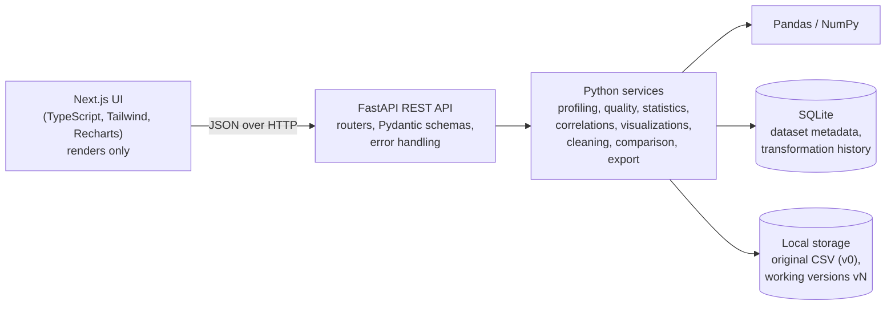

# DataLens

**Turn raw datasets into actionable insights.**

DataLens is a local data-analysis web app. Upload a CSV and it profiles the file, scores its
data quality, computes descriptive statistics, charts distributions and correlations, and lets
you apply explicit cleaning steps. Every change is recorded, and the result can be compared
against the original and exported. A FastAPI service does all the analysis with Pandas and
NumPy. A Next.js interface displays the results.

> The uploaded file is never modified. Cleaning works on a versioned working copy, and nothing
> is changed without you asking for it. There is no machine-learning or anomaly-detection
> component.

## What It Does

1. **Upload** a CSV (up to 50 MB by default). Encoding is detected automatically (UTF-8, UTF-8 with
   BOM, or Windows-1252/ISO-8859-1), and the file is stored under a generated ID.
2. **Profile** shows row and column counts, inferred column types (numeric, categorical, boolean,
   datetime), missing values, and sample values.
3. **Data Quality** gives a 0–100 score with a penalty breakdown that sums exactly to the lost
   points, plus a list of issues. Each issue has a severity and a suggested action.
4. **Statistics** gives type-specific summaries for every column.
5. **Explore** shows a correlation heatmap (Pearson or Spearman), a histogram, category frequencies,
   a scatter plot, a box-plot summary, and a datetime trend.
6. **Clean** applies one reviewed step at a time: fill missing values, remove duplicates, normalize
   text, drop or rename columns, or convert types. Each step creates a new working version.
7. **Compare & Export** shows the original next to the current version, lists every applied step
   in order, and downloads the current cleaned CSV.

## Features

- Encoding detection with a confidence check. Undetectable or binary content is rejected rather
  than guessed.
- Malformed-CSV errors name the row and the field-count mismatch.
- Explainable quality score: each problem category has a documented rate and cap, so the breakdown
  always adds up.
- Descriptive statistics for numeric, categorical, boolean, and datetime columns.
- Correlation analysis that excludes constant and sparse columns and states why.
- Chart responses are bounded: histogram bins are capped, categories show Top N plus "Other", and
  scatter plots return at most 2,000 points from a seeded sample.
- Explicit cleaning operations with a plain-language refusal when a step would change nothing or
  can't be done safely (for example, a text that isn't a number).
- Before/after comparison. Dataset metrics come from the same engines as the rest of the app.
  Operation totals (rows removed, values filled, columns dropped or renamed) come from the recorded
  history.
- Transformation history, shown with version, row counts, and timestamp.
- Cleaned CSV export with a safe filename. The export is read-only and streams the working file
  exactly as it is.

## Screenshots

> Screenshots are not committed yet. To add them, run the app with the sample data, capture the
> views below, and save them to `docs/screenshots/` with these names:
>
> - `docs/screenshots/dashboard-quality.png`: Data Quality tab with the score breakdown
> - `docs/screenshots/explore.png`: Explore tab with the correlation heatmap
> - `docs/screenshots/clean.png`: Clean tab, showing the review step before applying
> - `docs/screenshots/compare.png`: Compare & Export tab with the history list

## Architecture



In text: the Next.js frontend calls the FastAPI REST API. The API hands work to Python services,
which use Pandas and NumPy. The services store metadata and history in SQLite, and store CSV files
on local disk. All analysis happens in Python, and the frontend never computes statistics.

## Technology Stack

**Backend:** Python 3.11, FastAPI, Pydantic v2, pydantic-settings, Pandas, NumPy, SQLAlchemy 2.0,
SQLite, charset-normalizer (encoding detection), Uvicorn, pytest.

**Frontend:** Next.js 16 (App Router), React 19, TypeScript, Tailwind CSS 4, Recharts 3, ESLint.

## Project Structure

```
data-lens/
├── backend/
│   ├── app/
│   │   ├── main.py          # app factory: CORS, error handlers, routers
│   │   ├── api/             # routes/ (HTTP boundary), dependencies, error summaries
│   │   ├── core/            # settings, exception hierarchy, numeric and type helpers
│   │   ├── db/              # engine per settings, sessions, schema init
│   │   ├── models/          # SQLAlchemy models: Dataset, Transformation
│   │   ├── schemas/         # Pydantic request and response models
│   │   └── services/        # all analysis and file logic (no HTTP here)
│   ├── tests/               # pytest suite (API, services, and file-safety tests)
│   ├── requirements.txt
│   └── .env.example
├── frontend/
│   ├── src/app/             # pages: landing page and dataset dashboard
│   ├── src/components/      # Profile, Quality, Statistics, Explore, Clean, Compare views
│   ├── src/lib/             # typed API client and display formatting
│   └── .env.example
├── sample_data/             # deterministic demo CSVs and their generator script
└── PROJECT_SPEC.md          # engineering specification and phase record
```

## Getting Started

You need Python 3.11, Node.js 20 or later, and Git.

### Backend

Run these from the `backend/` folder.

**Windows (PowerShell)**

```powershell
python -m venv .venv
.venv\Scripts\activate
pip install -r requirements.txt
copy .env.example .env          # optional; the defaults work as they are
uvicorn app.main:app --reload
```

**macOS / Linux**

```bash
python3.11 -m venv .venv
source .venv/bin/activate
pip install -r requirements.txt
cp .env.example .env            # optional
uvicorn app.main:app --reload
```

The API runs at http://localhost:8000. Interactive docs are at http://localhost:8000/docs.

Settings are read from environment variables with the `DATALENS_` prefix, or from `backend/.env`.
The defaults are shown in [`backend/.env.example`](backend/.env.example). The database and uploads
live in `backend/data/`, which is git-ignored.

### Frontend

Run these from the `frontend/` folder.

**Windows (PowerShell)**

```powershell
npm install
copy .env.example .env.local
npm run dev
```

**macOS / Linux**

```bash
npm install
cp .env.example .env.local
npm run dev
```

Open http://localhost:3000. The app reads the API address from `NEXT_PUBLIC_API_BASE_URL`, which
defaults to `http://localhost:8000`.

### Demo data

Sample datasets are in [`sample_data/`](sample_data/). Upload them through the landing page, or
regenerate them with the included script (see [`sample_data/README.md`](sample_data/README.md)).

## Testing

```bash
# Backend: full pytest suite (run from backend/ with the virtualenv active)
pytest

# Frontend: type check and lint (run from frontend/)
npx tsc --noEmit
npm run lint

# Frontend: production build
npm run build
```

The backend suite covers the CSV and encoding handling, the profiler, the quality and statistics
engines, correlation and chart data, cleaning operations, versioned writes, comparison, history,
export, and the API error responses. Every test uses its own temporary database and upload folder.

## API

All responses are JSON, except for the export, which is a CSV download. Errors use one shape:
`{"error": "<ErrorName>", "message": "<readable text>"}`. Validation errors also include `details`.

| Method | Path | Purpose |
| --- | --- | --- |
| `GET` | `/api/health` | Service status |
| `POST` | `/api/datasets/upload` | Upload a CSV (multipart `file`) |
| `GET` | `/api/datasets` | List datasets |
| `GET` / `DELETE` | `/api/datasets/{id}` | Get or delete a dataset (delete also removes its working copies) |
| `GET` | `/api/datasets/{id}/profile` | Profile of the current version |
| `GET` | `/api/datasets/{id}/quality` | Quality score, breakdown, and issues |
| `GET` | `/api/datasets/{id}/statistics` | Per-column statistics |
| `GET` | `/api/datasets/{id}/correlations?method=pearson\|spearman` | Correlation matrix and strong pairs |
| `GET` | `/api/datasets/{id}/visualizations/histogram` | Histogram bins and counts |
| `GET` | `/api/datasets/{id}/visualizations/categorical` | Top-N category counts plus "Other" |
| `GET` | `/api/datasets/{id}/visualizations/scatter` | Bounded, seeded scatter sample |
| `GET` | `/api/datasets/{id}/visualizations/distribution` | Box-plot summary |
| `GET` | `/api/datasets/{id}/visualizations/datetime-trend` | Aggregated trend per period |
| `POST` | `/api/datasets/{id}/clean` | Apply one cleaning operation (JSON body, discriminated on `operation`) |
| `GET` | `/api/datasets/{id}/comparison` | Original vs current metrics, plus operation totals |
| `GET` | `/api/datasets/{id}/transformations` | Applied-step history, oldest first |
| `GET` | `/api/datasets/{id}/export` | Current working CSV as an attachment |

Interactive documentation: http://localhost:8000/docs (disabled when `DATALENS_ENVIRONMENT=production`).

## Engineering Decisions

- **Immutable originals.** The upload is stored once as version 0 and is never written again.
  Cleaning writes new files, and comparison, history, and export only read.
- **Working dataset versions.** Each cleaning step writes `{id}.v{n}.csv`. A `working_version`
  pointer selects the current one, and every analysis reads through that pointer, so nothing is
  served from a stale version.
- **Atomic writes.** A new version is written to a temporary file and moved into place with
  `os.replace`. The pointer moves only after the file is complete and its database row is
  committed. A failed step leaves the previous version in place.
- **Explainable quality scoring.** Each problem category has a fixed, documented rate and cap.
  Penalties are whole numbers, computed once and reused for both the breakdown and the score.
- **Python-side analytics.** Pandas and NumPy do all calculations. The frontend only renders what
  the API returns, so the numbers on screen can be checked against the API.
- **Bounded visualization responses.** Histogram bins are capped, categories show Top N, and
  scatter plots return at most 2,000 points from a seeded sample. Correlations are computed on all
  usable rows. Chart payloads stay small regardless of the file size.
- **Structured transformation history.** Each step is stored as structured data (operation,
  column, validated parameters, row counts, version). Sentences in the UI are built from those
  fields, so the history is queryable and the text can't drift from the data.
- **Safe file handling.** Stored names are generated UUIDs, so user filenames never become paths.
  Upload size is enforced while the file streams. Export filenames keep only a safe character set.

More detail is in [`PROJECT_SPEC.md`](PROJECT_SPEC.md).

## Limitations

- **Upload size.** The default limit is 50 MB (`DATALENS_MAX_UPLOAD_SIZE_MB`). Each analysis loads
  the whole file into memory, so this is a portfolio-scale tool, not a large-dataset system.
- **Local file storage.** CSVs and version files sit on the local disk. There's no object storage
  and no cleanup of files left behind if the process crashes mid-write.
- **SQLite.** Metadata is in a single SQLite file. Schema changes use a small inline migration, not
  Alembic.
- **Single-process lock.** Cleaning steps are serialized with an in-process lock. Running several
  server workers would need a database-level lock.
- **No undo.** Each step deletes the previous working copy when it commits. Undoing a step would
  need extra version retention, which was judged not worth the risk. Use the original upload to
  start over.
- **No "values modified" metric.** Row positions shift when duplicates are removed, so
  row-by-row comparison would be misleading. Operation totals come from history instead.
- **Conversion is strict.** Numbers with currency symbols or thousands separators are refused, not
  repaired.
- **Export encoding.** Cleaned exports are UTF-8 without a BOM, so some Excel setups may misread
  accented characters. Import the file with UTF-8 selected. The export streams the working file's
  bytes exactly, which is intentional.
- **No authentication.** The API has no users or access control. Run it on a trusted machine.
- **Datetime detection** needs at least 90% of sampled values to parse as dates. Mostly malformed
  columns are treated as text.

## Future Improvements

- Chunked processing for files larger than the current limit.
- Object storage for uploads and versions.
- Database-level locking, so several server workers can run safely.
- Richer version history, for example per-value change logs.
